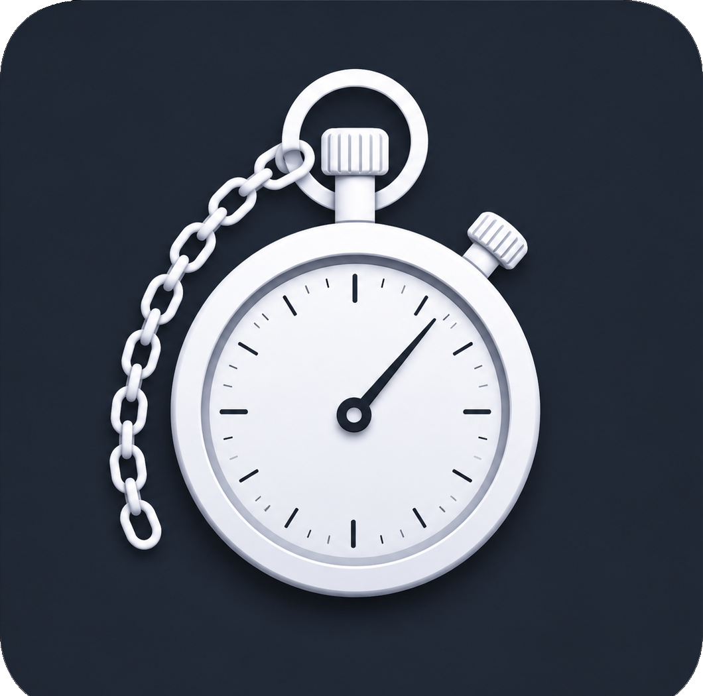
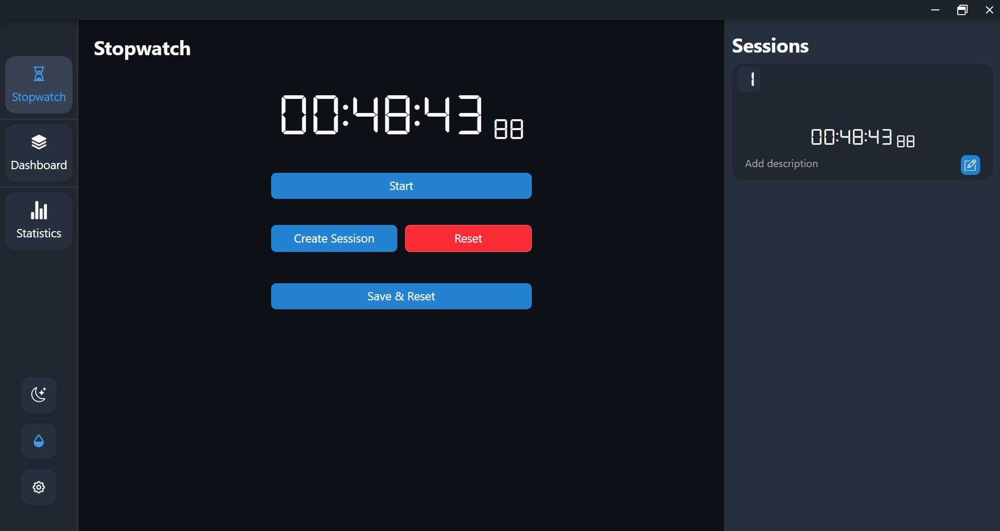
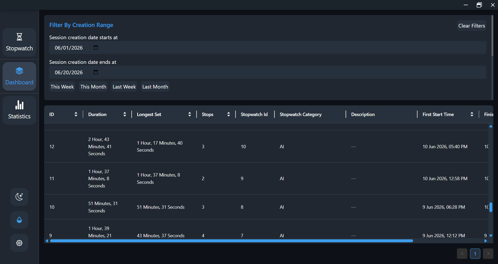
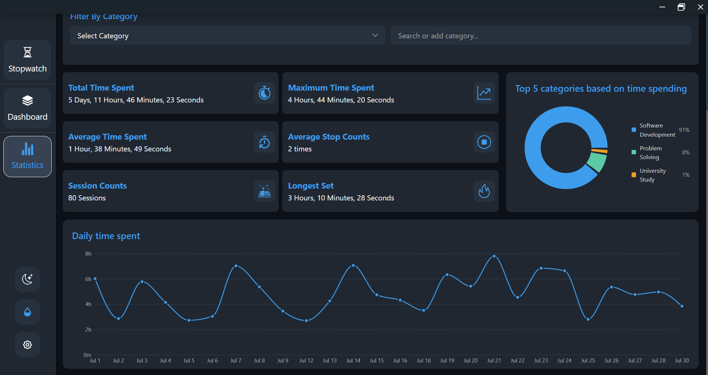
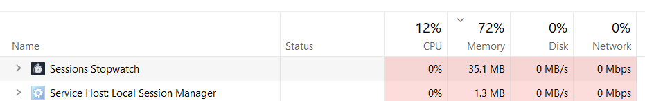

<table>
  <tr>
    <td></td>
    <td><strong>Session-Stopwatch</strong></td>
  </tr>
</table>

this is a simple desktop application I use to measure and analyze the time I spend on something, usually I use it to track my study time, and in the end of every month/week I check how much time I spent, how many times I got distracted and some other statistical things

## How it works
it's very simple, open the app. click start, whenever you want to stop the session click stop. While you can organize it a little bit, like every stopwatch is a day, and every session... well you got a create session button


once you finished you can either check the sessions you have registered via table view, and you can filter by many criteria 


or you can check the statistics from the statistics view and you can filter by many criteria


the Application is really lightweight so you can run it with anything you are doing



the application is build with:
- Node JS
- Electron JS
- React JS
- SQLite

## Building the Project
I used `electron-builder` to build the project for my operating system, you can use your own


Download the required binaries for your operating system and create for them a binaries/ directory.
For example:
```
binaries/
├── win/
├── mac/
└── linux/
```
Then update the build section in package.json to include the binaries:

```json
{
  "build": {
    "extraResources": [
      {
        "from": "binaries/",
        "to": "binaries"
      }
    ]
  }
}
```
Make sure you download the binaries appropriate for the OS you're building for.

## Got an Idea ?
The application is free and open-source. If you'd like to contribute feel free to submit a pull request

# Faced a Bug ?
If you encounter any bugs, please report them in the issues sections

## License

This project is open source and licensed under the [MIT License](LICENSE).
